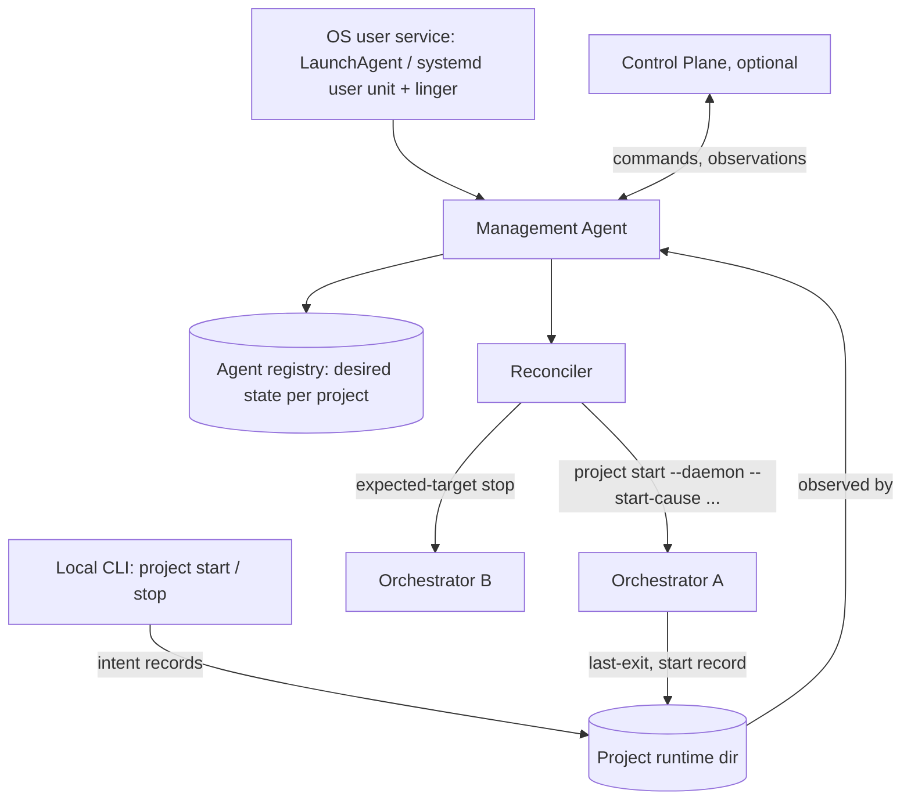

# Supervised project lifecycle: desired state, operator intent and reboot recovery

- **Date:** 2026-10-11
- **Status:** Draft — operator decisions D1–D4 recorded on 2026-10-11; architecture review pending
- **Symphony Layers:** Configuration, Coordination, Integration, Observability; Execution at the host process lifecycle boundary
- **Scope:** Proposed follow-up to the Control Plane Epic; this document does not describe shipped commands or APIs
- **Tracking:** Follow-up Epic to be opened after [Epic #983](https://github.com/hojinzs/github-symphony/issues/983) completes
- **Related documents:** [Control Plane and environment management agents](2026-10-04-control-plane-management-agents-design.md), [Orchestrator OpenTelemetry export](2026-10-04-otlp-export-design.md), [Standalone project model](2026-08-11-standalone-project-model-design.md), [single-repo orchestrator ADR](../adr/2026-05-04_single-repo-orchestrator.md)

## Problem

Orchestrators run as detached `project start --daemon` processes. Nothing
starts them again after a host reboot, logout or crash. Operators with several
project folders on one machine have to restart every folder by hand after each
reboot, and they usually notice only when issues stop moving.

The Control Plane design deliberately leaves this out of its first release:
"Host reboot or an orchestrator crash does not automatically restart projects
in this release. The operator starts them explicitly." Its only OS service is
the Management Agent, and orchestrators run outside the agent's service scope.

This document adds the missing piece. The agent records which projects should be
running and reconciles them after the agent starts, which covers reboot, and
continuously, which covers crashes. It also defines how operator intent
expressed outside the agent reaches the agent.

## Recorded decisions

| ID  | Decision                                                                                                                               | Consequence                                                                                                                                                       |
| --- | -------------------------------------------------------------------------------------------------------------------------------------- | ----------------------------------------------------------------------------------------------------------------------------------------------------------------- |
| D1  | Supervision is opt-in per project. Registering a project does not enable it.                                                           | Existing registrations and v1 upgrades keep current behaviour. A rehearsal or sandbox folder can be registered without restarting on every boot.                  |
| D2  | A human stop is respected, and the agent must learn about it even when it was issued with the local CLI rather than through the agent. | The CLI and orchestrator must record operator stop intent durably. The agent treats a recorded intent as a change of desired state, never as a failure to repair. |
| D3  | The agent supports a local-only mode without Control Plane enrollment.                                                                 | Reboot recovery works for single-machine operators who run no Control Plane. Enrollment can be added later without reinstalling the service.                      |
| D4  | This work is a follow-up Epic, started after Epic #983 completes.                                                                      | The #983 v1 statement on reboot remains true for v1. This design amends it for the next release.                                                                  |

## Non-goals

- Per-project launchd/systemd units. They create a second lifecycle authority
  that would restart projects a human or the Control Plane stopped, and they
  bypass the agent's journal and expected-target stop fencing.
- Supervising single-project container deployments. `tini` with the container
  restart policy, the existing Dockerfile path, remains the documented external
  supervisor.
- Pre-login machine boot on macOS (privileged LaunchDaemons), as in #983.
- Draining in-flight work before a stop, automatic CLI upgrades, relocating
  projects between environments, and Windows.

## Authority model



| Component            | Owns                                                                                                   | Does not own                                        |
| -------------------- | ------------------------------------------------------------------------------------------------------ | --------------------------------------------------- |
| Agent registry       | Desired state for each registered project, supervision counters and the reason for the current state   | Workflow policy, scheduler state                    |
| Reconciler           | Comparing desired and observed state, then starting or stopping through the existing lifecycle adapter | Signalling processes it did not verify, force kill  |
| Orchestrator and CLI | Recording start cause, operator stop intent and exit reason                                            | Deciding whether to restart                         |
| Control Plane        | Displaying desired and observed state and editing desired state through commands                       | Holding desired state. It caches the agent's value. |

Desired state is local to the agent so that reboot recovery works while the
Control Plane is unreachable or absent. The rules from #983 still hold:
orchestrators outlive the agent, agent shutdown never signals them, and an agent
restart adopts running orchestrators instead of replacing them.

## Desired state

Each registry entry gains:

```ts
type DesiredState = "unset" | "running" | "stopped";

interface ProjectSupervision {
  desired: DesiredState; // "unset" = not supervised (D1 default)
  desiredSetAt: UtcTimestamp;
  desiredSetBy: "local-cli" | "agent-cli" | "control-plane" | "reconciler";
  state: // reconciler's view, see below
    | "idle"
    | "starting"
    | "running"
    | "stopping"
    | "stopped"
    | "backoff"
    | "crash_loop"
    | "blocked_config";
  restartWindow: { startedAt: UtcTimestamp; count: number };
  lastExit?: ExitRecord;
  lastStartCause?: StartCause;
}
```

`unset` means the agent observes and reports the project but never starts or
stops it on its own. That is the #983 v1 behaviour.

### Who changes desired state

The rule is **latest human intent wins**. It applies only to supervised projects
(`desired != unset`).

| Event                                                                       | Effect on a supervised project                                                    |
| --------------------------------------------------------------------------- | --------------------------------------------------------------------------------- |
| Control Plane start / stop command                                          | Set `running` / `stopped`, then reconcile at once                                 |
| `gh-symphony agent project start\|stop <id>`                                | Same as above, locally                                                            |
| Local `gh-symphony project stop` observed (matching stop intent, see below) | Set `stopped` (D2)                                                                |
| Local `gh-symphony project start` observed (`startCause=operator`)          | Set `running`                                                                     |
| Orchestrator exits for any other reason                                     | No change. Reconciler restarts it.                                                |
| `agent project autostart <id> on\|off`, or the Control Plane toggle         | `on`: set `running` if observed running, otherwise `stopped`. `off`: set `unset`. |

Local actions on an `unset` project change nothing. The agent only reports them.

## Operator intent propagation (D2)

Today `project stop` sends `SIGTERM` and deletes `daemon.pid` without waiting
(`packages/cli/src/commands/stop.ts`). A stop issued by a human and the
`SIGTERM` delivered at OS shutdown or logout are indistinguishable to the
orchestrator and to anything observing it afterwards. The fix is to record
intent before the signal, and to record the exit separately.

### Records in the project runtime directory

All three files live under `<runtimeRoot>/projects/<projectId>/lifecycle/`, are
written atomically (temp file + rename) and are readable by the agent's
`LocalReadAdapter`.

```ts
// Written by whoever requests a stop, BEFORE signalling.
interface StopIntent {
  version: 1;
  requestedAt: UtcTimestamp;
  requestedBy: "local-cli" | "agent";
  commandId?: UUID; // agent/Control Plane originated
  target: { pid: number; processIdentity: string; instanceId: UUID };
  force: boolean;
}

// Written by the orchestrator once its locks are held (beside the ready file).
interface StartRecord {
  version: 1;
  instanceId: UUID; // same UUID as OTLP service.instance.id
  pid: number;
  processIdentity: string;
  startedAt: UtcTimestamp;
  startCause: StartCause;
  cliVersion: string;
}
type StartCause =
  | "operator" // default for a human running project start
  | "control_plane"
  | "agent_cli"
  | "boot_recovery" // reconciler, first pass after agent start
  | "crash_recovery"; // reconciler, unexpected exit while agent ran

// Written by the orchestrator on the way out, best effort.
interface ExitRecord {
  version: 1;
  instanceId: UUID;
  exitedAt: UtcTimestamp;
  reason:
    | "operator_stop"
    | "signal"
    | "lease_lost"
    | "fatal_startup"
    | "fatal_runtime";
  signal?: string;
  diagnostic?: Diagnostic; // redacted; e.g. workflow validation code
}
```

`instanceId` is absent when no orchestrator process was created. Workflow
preflight (`preflightWorkflowStart` in `packages/cli/src/commands/start.ts`)
fails in the CLI parent before any daemon or lock exists, so on a preflight
failure the CLI parent itself writes `last-exit.json` with
`reason: "fatal_startup"` and the validation diagnostic, then exits non-zero.

`project start` gains `--start-cause <cause>` (hidden, default `operator`). The
agent always passes it. The daemon parent forwards it to the child.

### How a stop is classified

The stop intent, not the exit record, is authoritative, because a forced stop,
`SIGKILL` or a crash during shutdown may never write `last-exit.json`:

1. A `StopIntent` whose `target` matches the exited instance (`instanceId`, or
   PID plus process identity) means the stop was intended. If `requestedBy` is
   `local-cli`, the agent sets desired to `stopped` and journals the change
   with `origin=local-cli`.
2. No matching intent means an unintended exit: OS shutdown, logout, crash,
   lease loss, OOM. The reconciler restarts the project if desired is `running`.
   The exit record, or its absence, only classifies the cause for backoff,
   crash-loop counting and telemetry.
3. `fatal_startup` with a workflow validation diagnostic moves the project to
   `blocked_config` rather than restarting it (see Reconciler). This covers
   both preflight failures written by the CLI parent and validation failures
   inside the orchestrator.

The stopper removes its intent when the signal fails after the intent was
written (`process.kill` throws `EPERM`, or the identity re-check in
`packages/cli/src/commands/stop.ts` rejects the target). As a backstop for a
stopper that dies before cleanup, an intent matches only when the exit happens
within the 60 s stop timeout of `requestedAt`. A later crash of the same
instance is therefore an unintended exit and is restarted.

An intent whose target never matches a running instance (stop of an already
stopped project, PID reuse) is ignored. The next successful start deletes the
consumed intent. Matching on `instanceId` already makes a stale intent
harmless; deletion keeps the directory small.

The agent learns of local actions it did not perform by observation, not
notification. It reads the lifecycle records on its observation interval
(5 s, as in #983) and when its file watch fires. If the agent is not running
when the human acts, it finds the same records on its next start, before the
boot pass. That ordering matters: a project stopped by hand just before a
reboot must not come back after the reboot.

## Reconciler

### Triggers

- **Boot pass:** once after the agent starts, before the first observation post.
  It covers reboot and login.
- **Observation tick:** every 5 s, and on lifecycle file changes.
- **Command:** immediately after a desired-state change.

### Per-project step (serialized per project, as in the #983 lifecycle adapter)

```
observe(process via resolveDaemonLiveness + locks, lifecycle records)
apply local intent (above) → may change desired
if desired == running and not running:
    if state in {crash_loop, blocked_config}: wait for release condition
    elif backoff not elapsed: wait
    else: start(--start-cause boot_recovery | crash_recovery), await readiness
if desired == stopped and running:
    expected-target stop (write StopIntent requestedBy=agent first)
```

Reconciler starts use the same isolated launch path as other agent starts: a
separate transient systemd user service per project on Linux (C11) and a
separate process group with `AbandonProcessGroup` on macOS (C12). Orchestrators
therefore never run inside the agent's own unit or process group, and agent
restart or crash leaves them running.

`start` of an already running project is a success. The existing start locks
refuse a duplicate with "already running", so a race with a human `project start`
cannot produce two orchestrators.

### Guards

| Guard                       | Rule (proposed defaults)                                                                                                                                        |
| --------------------------- | --------------------------------------------------------------------------------------------------------------------------------------------------------------- |
| Boot staggering             | At most 2 concurrent starts, each awaiting the existing readiness signal (10 s) before the next begins. Order: last observed running first.                     |
| Backoff                     | Unintended exits restart after 10 s, doubling to a 5 min cap; reset after 10 min of continuous running.                                                         |
| Crash-loop breaker          | 5 unintended exits within 10 min → `crash_loop`. Desired stays `running`. Released by an explicit start (local or Control Plane) or a workflow revision change. |
| Invalid configuration       | `fatal_startup` with a validation diagnostic → `blocked_config`, no retries. Released when `workflowRevision` changes.                                          |
| Network not ready at boot   | Start failures that occur before readiness count toward backoff but not toward the crash-loop breaker during the first 5 min after agent start.                 |
| Lease loss after host sleep | `lease_lost` exits (self-`SIGTERM` in `lock.ts`) are unintended and restart normally; the lock refuses the restart while another live owner exists.             |

The reconciler never uses `--force` or `SIGKILL`. A stop that cannot be verified
within 60 s is reported as unresolved, as in #983.

### In-flight work

A reboot interrupts active runs. Existing recovery handles them on restart.
Graceful shutdown publishes assigned branches and terminates workers
(`service.ts` shutdown). On the next start, `reconcileRun` requeues, releases
or restarts dead runs, and dirty workspaces resume in `<key>-recovery`.
This design adds no draining and relies on that path.

## Local-only mode (D3)

```
gh-symphony agent setup --local          # service install + start, no enrollment
gh-symphony agent project add <dir> [--autostart]
gh-symphony agent project autostart <id> on|off
gh-symphony agent project start|stop <id>
gh-symphony agent project list           # desired, observed, supervision state, last exit
gh-symphony agent enroll                 # later: attach to a Control Plane, no reinstall
```

The registry already represents an agent without an identity
(`identity: null` in `packages/management-agent/src/registry.ts`). In local-only
mode the transport loop is not started. Every other part — lock, journal,
reconciler, lifecycle adapter, OS service — is the same code path as an enrolled
agent. Enrolling later starts the transport. Desired state is not reset, and the
first observation reports it to the Control Plane.

`agent setup --local` and the enrolled `agent setup` share the C11/C12 service
packaging and report actual auto-start coverage:

| Platform                    | Service                                                  | Restarts projects after                                               |
| --------------------------- | -------------------------------------------------------- | --------------------------------------------------------------------- |
| macOS                       | user LaunchAgent, `RunAtLoad` + `KeepAlive` with backoff | user login (not pre-login boot); reboot, logout/login, agent crash    |
| Linux, linger enabled       | systemd user unit                                        | machine boot; agent crash                                             |
| Linux, no linger            | systemd user unit                                        | first login of the user only; setup explains `loginctl enable-linger` |
| Unsupported service manager | foreground `agent run`                                   | nothing automatic; not reported as installed                          |

## Control Plane changes

- **Command semantics:** for a supervised project, start/stop means "set desired
  state, then ensure". For an `unset` project the #983 v1 meaning, ensure at
  completion, is unchanged. Remote stop writes the desired state before signalling,
  under the existing per-project serialization, so the reconciler cannot race it.
- **New operation:** `set-autostart { enabled }`, journaled like start/stop.
- **Journal origin:** journal entries gain `origin`: `control-plane`,
  `agent-cli`, `local-cli` (observed) or `reconciler`, so the audit view shows
  "restarted by agent after boot" and "stopped locally by operator".
- **UI:** desired and observed columns, an autostart toggle, and badges for
  `crash_loop`, `blocked_config` and `backoff`, with last exit reason and
  restart count.

### Protocol additions (`management-protocol`)

```ts
interface ProjectObservation {
  // ...existing fields
  supervision?: {
    desired: DesiredState;
    desiredSetAt: UtcTimestamp;
    desiredSetBy: "local-cli" | "agent-cli" | "control-plane" | "reconciler";
    state: SupervisionState;
    restartsInWindow: number;
    lastExit?: Pick<ExitRecord, "reason" | "exitedAt" | "signal">;
    lastStartCause?: StartCause;
  };
}
type LifecycleOperation = "start" | "stop" | "set-autostart";
```

`supervision` is optional, so a v1 Control Plane ignores it and a v1 agent omits
it. `set-autostart` requires an agent that advertises the capability in its
session request. A Control Plane must not send it to an agent that does not.

## Observability (OTLP)

### Orchestrator (extends the OTLP export design; no new resource attributes)

| Log record                       | Attributes                                                                                    |
| -------------------------------- | --------------------------------------------------------------------------------------------- |
| `symphony.orchestrator.started`  | `start.cause`, `previous_exit.reason`, `previous_instance.id`                                 |
| `symphony.orchestrator.stopping` | `stop.reason` (`operator_stop`, `signal`, `lease_lost`, `fatal_runtime`), `stop.requested_by` |

`service.instance.id` is the `StartRecord.instanceId`, so lifecycle files and
telemetry join on one key. Counters still reset per process, as the OTLP design
specifies. The 5 s shutdown flush must fit inside the OS termination grace
period together with the 10 s worker termination; see open questions.

### Agent (new resource, `service.name=gh-symphony-agent`)

An orchestrator cannot report that it is not running. Only the agent can.

| Metric                               | Type                            | Attributes                                                |
| ------------------------------------ | ------------------------------- | --------------------------------------------------------- |
| `symphony.project.supervision_state` | Gauge (1 for the current state) | `project.id`, `state`, `desired`                          |
| `symphony.project.restarts`          | Counter                         | `project.id`, `cause` (`boot_recovery`, `crash_recovery`) |
| `symphony.agent.reconcile.actions`   | Counter                         | `action` (`start`, `stop`, `noop`), `result`              |
| `symphony.agent.reconcile.duration`  | Histogram                       | `pass` (`boot`, `tick`)                                   |

With supervision, failures show up as restart churn rather than downtime.
`symphony.project.restarts` and `supervision_state{state="crash_loop"}` are
the alerting signals. Agent OTLP configuration lives in the agent's config file,
because the agent has no `WORKFLOW.md`. It uses the same contract shape as
`observability.otlp`: explicit enable, env-referenced headers, restart-required
reload.

## Compatibility and migration

- Amends the #983 design statement on reboot (lines 77–78) for the next release.
  It does not change CP-23: agent service lifecycle still never signals
  orchestrators.
- Registry `version: 1 → 2`: existing entries migrate to `desired: "unset"` (D1).
- Without `--start-cause`, an orchestrator records `operator`. An older CLI writes
  no lifecycle records, and the agent then treats every exit as unintended for
  supervised projects. `agent project autostart on` is therefore rejected when the
  configured CLI is too old to write stop intents.
- Operators who wrapped `start.sh`-style scripts in their own LaunchAgent should
  remove that job before enabling autostart. Otherwise the two only race on the
  start lock, which is harmless but noisy. Setup warns when it finds a running
  orchestrator whose parent is not the agent and whose start cause is `operator`.

## Test cases

| ID    | Scenario                                                                                                                      | Expected                                                                            |
| ----- | ----------------------------------------------------------------------------------------------------------------------------- | ----------------------------------------------------------------------------------- |
| SL-01 | Supervised running project; host reboot; user logs in                                                                         | Agent boot pass restarts it with `boot_recovery`; journal origin `reconciler`       |
| SL-02 | Unsupervised (`unset`) project; reboot                                                                                        | Not started; reported stopped                                                       |
| SL-03 | Human runs `project stop` while agent is running                                                                              | Desired becomes `stopped`; no restart; journal origin `local-cli`                   |
| SL-04 | Human runs `project stop` while agent is down, then reboot                                                                    | Boot pass applies the intent first; project stays stopped                           |
| SL-05 | Human runs `project stop --force` (SIGKILL)                                                                                   | Intent recorded before signal; treated as operator stop despite missing exit record |
| SL-06 | Orchestrator SIGKILLed with no intent                                                                                         | Restarted with `crash_recovery` after backoff                                       |
| SL-07 | Six unintended exits in 10 min                                                                                                | `crash_loop` after the fifth; released by explicit start or workflow change         |
| SL-08 | Invalid `WORKFLOW.md` at boot                                                                                                 | `blocked_config`, no retries; fixed file releases and starts it                     |
| SL-09 | Human runs `project start` on a project with desired `stopped`                                                                | Desired becomes `running`                                                           |
| SL-10 | Control Plane stop races reconciler restart                                                                                   | Desired written before signal; no restart; single journal outcome                   |
| SL-11 | Stale or aborted stop intent: previous instance, or signal failed after the intent was written and the instance later crashes | Ignored; deleted on next start; does not suppress restart                           |
| SL-12 | Network unavailable for 3 min after login                                                                                     | Starts retry with backoff; no `crash_loop`; all projects up after network           |
| SL-13 | Host sleep causes `lease_lost` exit                                                                                           | Restarted; no duplicate orchestrator                                                |
| SL-14 | `agent setup --local`, later `agent enroll`                                                                                   | Same service; desired state preserved and first observation reports it              |
| SL-15 | 13 supervised projects at boot                                                                                                | At most 2 concurrent starts; all ready                                              |
| SL-16 | Agent service stop/restart with supervised projects running                                                                   | Orchestrators keep running; restart adopts them without new starts                  |

## Delivery slices

1. **Lifecycle records (CLI and orchestrator only):** `lifecycle/` records,
   `--start-cause`, stop intent from `project stop` and the expected-stop
   socket, and `status` output exposing last exit and start cause. Independent of
   the agent. Also feeds the orchestrator OTLP start/stop log records.
2. **Protocol:** optional `supervision` observation, `set-autostart`, journal
   `origin`, capability advertisement.
3. **Agent supervision:** registry v2, reconciler, guards, intent observation,
   `agent project autostart|start|stop|list`.
4. **Local-only setup:** `agent setup --local` on the C11/C12 packaging, later
   enrollment without reinstall.
5. **Control Plane UI:** desired/observed, autostart toggle, supervision badges,
   audit origin.
6. **Agent telemetry:** agent OTLP config and the metrics above.
7. **Acceptance:** SL-01–SL-16 on macOS and Linux (with and without linger),
   including a real reboot on each.

Slice 1 has no dependency on #983 and can be scheduled ahead of the Epic if the
OTLP start/stop records are wanted earlier.

## Open questions

1. Does orchestrator startup fail fast or keep retrying when the tracker or
   GitHub is unreachable? The network guard assumes it fails before readiness;
   verify before choosing the 5 min grace window.
2. OS termination grace at shutdown/logout on macOS and under systemd user
   sessions, measured against the 10 s worker termination plus 5 s OTLP flush.
   Shipped C11/C12 values: the Linux agent unit uses `TimeoutStopSec=15s`, while
   project transient units use the user manager default; the macOS agent uses
   `ExitTimeOut=20`, which does not cover the abandoned project process groups.
   If it is shorter, shutdown records may be lost. Classification still works
   because it relies on the stop intent.
3. Should `boot_recovery` be distinguished from an agent-only restart? With
   the agent crashing alone, orchestrators keep running and nothing is
   restarted, so the distinction may only matter for telemetry.
4. Stop-intent placement for projects whose runtime root is
   `<folder>/.runtime/orchestrator` rather than `~/.gh-symphony`: the agent
   must resolve the same canonical runtime as `resolveCanonicalRuntime`.
5. Restart ordering: should projects with active runs at shutdown (from
   `issues.json`) be started first?
